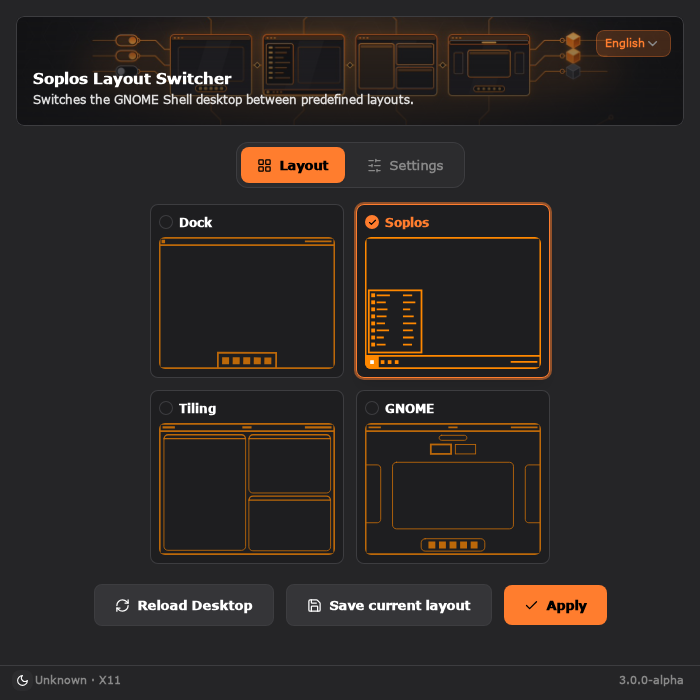
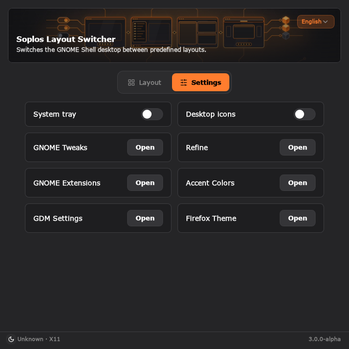
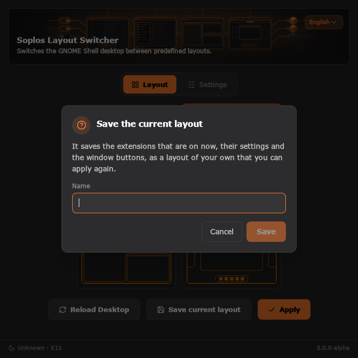

# Soplos Layout Switcher 3.0


GNOME Shell layout presets for Soplos Linux.

Switches the GNOME Shell desktop between four predefined layouts, Soplos, Dock, Tiling and GNOME, by turning on the shell extensions each one needs, turning off those of the other layouts and applying the matching settings. It only runs under GNOME, with X11 or Wayland.

Ported from [gnome-layout-switcher](https://gitlab.manjaro.org/Chrysostomus/gnome-layout-switcher) (Manjaro Linux) and adapted for Debian.

|  The four layouts, one chosen, with Apply and Reload Desktop |  Settings: the switches and the tools of the desktop |
|:---:|:---:|
|  Saving the desktop as it is now as a layout of your own | |

## Status

This is the first alpha of the rewrite. The four layouts, the Settings page and the command line are those of the 2.x program, written again in Rust and Svelte. It has not yet been tested on real hardware: report anything that fails.

## Layouts

- **Soplos**: the default Boro appearance: Dash to Panel and ArcMenu with the Soplos branding, Desktop Icons NG and Quick Settings Tweaks.
- **Dock**: a macOS-style dock (Dash to Dock, at the bottom).
- **Tiling**: Forge (tiling window manager), Dash to Dock (on the left), Open Bar (top bar theming), AppIndicator, Blur my Shell and Workspace Indicator. Forge and Open Bar have no Debian package and no working build on extensions.gnome.org for current GNOME Shell versions, so they ship with this program (`data/extensions/`).
- **GNOME**: stock GNOME Shell, with no extra extensions.

Five extensions (Coverflow Alt-Tab, Clipboard Indicator, Desktop Cube, Removable Drive Menu and User Themes) are the user's own taste, and no layout touches them.

## Architecture

Version 3.0 is a rewrite of Soplos Layout Switcher. The original app was written in Python 3 with GTK3 (PyGObject). This rewrite replaces that stack with Tauri 2: a Rust backend and a Svelte 4 + Tailwind CSS frontend, rendered through the system's WebKitGTK.

- **Backend** (`src-tauri/`): the layouts as data (`src/commands/layouts.rs`), the installation of the extensions (`extensions.rs`), the settings page and the file that remembers the layout (`settings.rs`), the privileged helper (`privileged.rs`) and the environment (`environment.rs`).
- **Frontend** (`src/`): one window with the frame of the other Soplos 3.0 programs without a sidebar (a hero with the language, a thin footer with the theme button, the session and the version), the two pages, shared dialogs, the progress bar along the bottom edge while a job runs, and the 8-language dictionaries under `src/i18n/`.
- **Privileges**: the window itself never runs as the superuser. The only thing that needs it is installing the Debian packages of the extensions: the same executable is started through `pkexec` with a closed request (the packages, from a list of five), validated in the window and again as the superuser. The password is asked once, whatever the number of packages. The Polkit action is declared in `src-tauri/resources/polkit/org.soplos.layoutswitcher.policy`.

## Installation

```bash
sudo apt install soplos-layout-switcher
```

## Features

- **Four layouts**: a picture of each, one chosen, and Apply. Reload Desktop restarts the shell on X11 and closes the session on Wayland.
- **Extensions installed for you**: before a layout is applied, the extensions it needs are installed if they are missing: from their Debian package, from the ones that ship with the program, or from extensions.gnome.org. What cannot be installed is left to you in the extensions manager.
- **Your own layouts**: Save current layout keeps the desktop as it is now (the extensions that are on, their settings and the window buttons) under a name. It becomes a card after the four of the program, which can be applied or deleted. They are kept in `~/.config/soplos-layout-switcher/layouts/`.
- **Settings**: switches for the system tray and the desktop icons, and buttons that open GNOME Tweaks, Refine (the alternative to GNOME Tweaks), the extensions manager, GNOME Settings (accent color), GDM Settings and Add Water (Firefox theming). Refine and Add Water are Flatpaks, installed from Flathub for the user the first time.
- **Command line**: `soplos-layout-switcher-cli` with `apply-soplos`, `apply-dock`, `apply-gnome`, `apply-tiling` and `reload-gnome-shell`, for scripts and installers.
- **Light and dark**: the window follows the theme of the desktop, with a button in the footer to choose.

## Dependencies

- `gnome-shell`, `pkexec` (Polkit), `curl` and `dconf-cli`.
- Recommended: the packages of the extensions (`gnome-shell-extension-dashtodock`, `gnome-shell-extension-dash-to-panel`, `gnome-shell-extension-arc-menu`, `gnome-shell-extension-appindicator`, `gnome-shell-extension-desktop-icons-ng`), `gnome-tweaks` and `flatpak`.

## Keyboard shortcuts

| Shortcut | Action |
|---|---|
| F1 | Open About dialog |
| Ctrl+Q | Quit application |

## Documentation

A Unix manual page is included and installed with the package:

```bash
man soplos-layout-switcher
```

## Languages

The interface is available in 8 languages: English, Español, Deutsch, Français, Italiano, Português, Română and Русский. It starts in the system language and falls back to English.

## Building

```bash
npm install
npm run tauri dev      # development
./package.sh           # builds the .deb and moves it to ~/Descargas/SoplosApps
```

## License

Copyright © 2026 Sergi Perich <info@soploslinux.com>. Published under the GPL-3.0-or-later license. See `LICENSE`. The two extensions in `data/extensions/` keep their own licenses.
